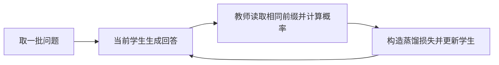

> **OPD（On-Policy Distillation，同策略蒸馏）：学生先自己作答，教师再对学生实际走过的路径提供学习信号。**

这篇只讲理解和面试需要的核心内容，约 8 分钟。先记一句话：**学生出轨迹，教师给反馈，更新后重新采样。**

## 1. 为什么不直接学教师的答案

普通的离线蒸馏可以先收集教师回答，再对学生做 SFT。问题是，学生推理时未必走得出教师的路径：一旦中间写错，后面遇到的上下文就可能没在训练里见过。

OPD 把训练放到学生自己会遇到的前缀上。比如学生在数学题中写出了一个错误中间式，教师看到的是**这个已经写错的前缀**，而不只是自己的标准答案。这样可以减少训练与推理的分布差异。[GKD 原论文](https://arxiv.org/abs/2306.13649)

注意，教师的 token 概率表达的是“这个前缀下，我倾向怎样继续”，**并不直接等于数学步骤是否正确**。因此 OPD 提供的是分布反馈，不应把它当成逐步真值验证器。

## 2. 一轮训练怎么走



1. 取 prompt，通常不要求已有标准回答或 chosen/rejected 对。
2. 用当前学生生成 response，得到它自己的 rollout。
3. 教师读取 prompt + 学生 response，在相同前缀下给出下一 token 分布或已采样 token 的 log 概率。
4. 计算损失，只更新学生；教师通常冻结。
5. 学生变了，就继续生成新的轨迹。

教师不一定要重新生成整段回答；对给定学生轨迹，通常可以用一次 teacher-forcing 前向计算多个位置的概率。

**On-policy 说的是轨迹来自谁；KL 方向说的是如何比较分布。** GKD 可以在学生轨迹上使用 forward KL、reverse KL 或其他散度，两者不要混为一谈。[GKD Trainer 文档](https://huggingface.co/docs/trl/gkd_trainer)

## 3. 反向 KL 到底比较什么

在学生生成的前缀 $s_t=(x,y_{<t})$ 上，记学生下一 token 分布为 $p_S$，教师为 $p_T$。一种常用损失是：

$$
D_{KL}(p_S\|p_T)=\sum_v p_S(v|s_t)\left[\log p_S(v|s_t)-\log p_T(v|s_t)\right]
$$

- 求和对象是词表里的所有 token $v$。
- 学生把概率放到教师极不看好的 token 上时，惩罚会比较大。
- 它倾向于聚焦教师较认可的模式；这不意味着必然找到正确答案或覆盖所有解法。[MiniLLM 原论文](https://arxiv.org/abs/2306.08543)

与之相对，forward KL 是 $D_{KL}(p_T\|p_S)$，用教师概率加权，更重视学生不要漏掉教师支持的候选。

## 4. 两种实现：不要混着记

| | 完整词表分布匹配 | Sampled-token 策略梯度方式 |
|---|---|---|
| 教师提供什么 | 每个位置的词表分布 | 学生实际采样 token 的 log 概率 |
| 怎样更新 | 在固定的本批前缀上直接反传散度 | 把 log 概率差作为 token 级反馈，构造策略梯度损失 |
| 要记住的区别 | 对所有候选求和 | 用采样估计，不能直接拿一项 log 概率差反传当作完整 KL |

Thinking Machines 的配方采用第二种，token 级反馈为：

$$r_t=\log p_T(y_t|s_t)-\log p_{S,\mathrm{rollout}}(y_t|s_t)$$

教师相对更认可这个 token，反馈就更高。构造训练损失时，反馈要视为固定值；学生当前 log 概率负责提供梯度。该配方只使用当前 token 的即时反馈，不把未来 token 的奖励累计回来；复用 rollout 更新时还要处理新旧策略的概率比。[Thinking Machines 的 OPD 说明](https://thinkingmachines.ai/blog/on-policy-distillation/)

## 5. 最小代码：完整词表的反向 KL

下面只展示第一种实现的局部损失：**输入序列必须已经由学生生成**。函数本身没有 rollout 循环，不能仅凭这个函数就称为完整 OPD 训练器。

假设教师和学生的 tokenizer、词表 ID 一致；`response_mask` 与输入 token 对齐，回答有效 token 为 1，prompt 和 padding 为 0。

```python
import torch
import torch.nn.functional as F

def opd_reverse_kl(student_logits, teacher_logits, response_mask):
    # 两组 logits: [B, T, Vocab]；mask: [B, T]
    # 位置 t 的 logits 预测 token t+1，因此 mask 也要错位对齐。
    log_s = F.log_softmax(student_logits[:, :-1].float(), dim=-1)
    log_t = F.log_softmax(teacher_logits[:, :-1].float().detach(), dim=-1)
    kl_per_token = (log_s.exp() * (log_s - log_t)).sum(dim=-1)
    mask = response_mask[:, 1:].to(kl_per_token.dtype)
    return (kl_per_token * mask).sum() / mask.sum().clamp_min(1)

logits = torch.randn(1, 4, 8, requires_grad=True)
mask = torch.tensor([[0, 0, 1, 1]])
loss = opd_reverse_kl(logits, logits.detach(), mask)
print(loss.item())  # 同一分布，KL = 0
```

这里用有效回答 token 的均值归一化，并把本批采样前缀视为固定数据，不对离散生成过程反传。它不是完整序列 KL 的策略梯度实现。

## 6. 和已有后训练算法怎么区分

| 方法 | 典型训练数据 | 学习信号 | 最容易记的区别 |
|---|---|---|---|
| 教师回答上的 SFT | 预先收集的教师回答 | 正确 token 的交叉熵 | 学教师走过的路径 |
| OPD | 当前学生生成的回答 | 教师的 token 分布或概率反馈 | 在学生自己的路径上接受指导 |
| 标准离线 DPO | 同一问题的偏好回答对 | chosen/rejected 的相对偏好 | 不要求训练时持续 rollout |
| 常见的结果奖励 GRPO | 学生对同一问题的多条回答 | 答案奖励与组内相对优势 | 通常先评分，再计算组内优势 |

OPD 不要求专门的 critic，也不要求 GRPO 式组内标准化；它可以与强化学习更新结合，但不是“把 GRPO 的奖励模型换成教师”就解释完了。

## 7. 实现时重点检查什么

- **教师冻结、学生有梯度。** 教师前向用 `eval()` 和 `torch.no_grad()`；学生生成时无梯度，训练前向再保留梯度。
- **比较的是相同前缀。** 不要拿教师自己生成的答案位置，与学生另一条答案的位置直接对齐。
- **tokenization 要兼容。** 不同词表的 logit 不能按 token ID 直接相减；需要额外对齐方案。
- **rollout 要足够新。** 学生更新很多步后，旧轨迹不再严格对应当前策略；多轮复用应考虑重要性采样等修正。
- **初始化要有基础能力。** 学生如果很少生成有用路径，单靠在自身轨迹上匹配教师也可能学得慢；可先用 SFT 建立能力，再做 OPD。

这些是理解配方时的检查点，不代表所有 OPD 实现都采用相同的损失、采样比例和更新方式。

## 8. 面试前能回答这四问就够了

**为什么叫 on-policy？** 因为训练前缀来自当前学生自己的输出，随学生更新而变化。

**是不是必须用 reverse KL？** 不是。数据来源与损失函数是两个维度，reverse KL 只是常见选择。

**教师给的是正确性奖励吗？** 通常给的是 token 概率或分布反馈，不保证每个高概率 token 都正确。

**相对离线蒸馏的价值？** 学生能在自己实际会遇到的上下文上接受指导，减少只学教师轨迹带来的分布不匹配。

面试口述：“OPD 让学生先生成，再由教师沿同一轨迹提供 token 级反馈。核心是训练数据来自学生自己，损失可选 KL 等散度。它既要注意轨迹的新鲜度，也要区分完整词表匹配和 sampled-token 的策略梯度更新。”

## 参考阅读

- [GKD：Learning from Self-Generated Mistakes](https://arxiv.org/abs/2306.13649)：理解学生轨迹与分布不匹配问题。
- [MiniLLM](https://arxiv.org/abs/2306.08543)：理解反向 KL 蒸馏的动机。
- [Thinking Machines：On-Policy Distillation](https://thinkingmachines.ai/blog/on-policy-distillation/)：理解 sampled-token 的实践配方。
- [Hugging Face GKD Trainer](https://huggingface.co/docs/trl/gkd_trainer)：查看学生采样比例与散度选择。
